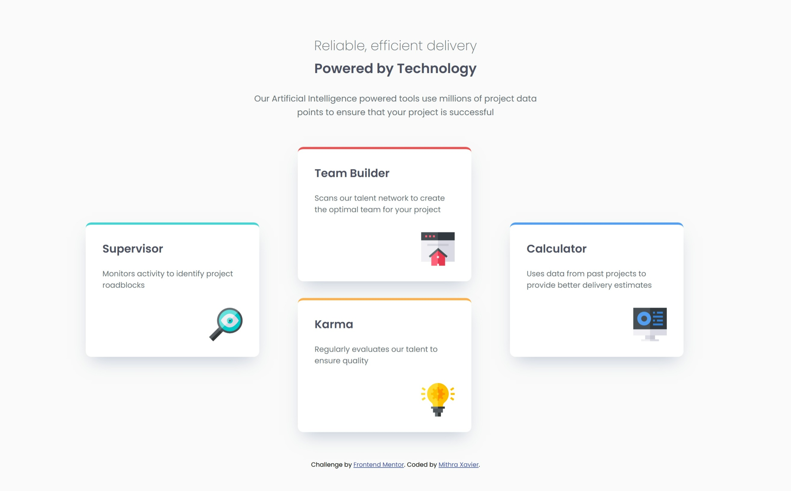
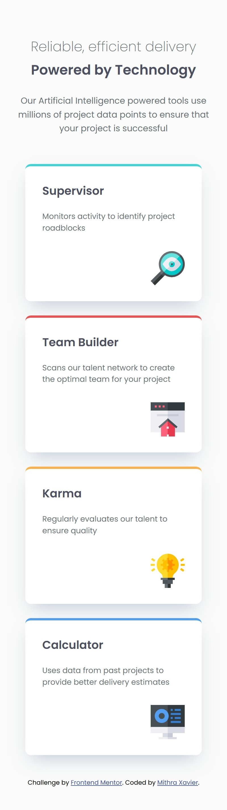

# Frontend Mentor - Four card feature section solution

This is a solution to the [Four card feature section challenge on Frontend Mentor](https://www.frontendmentor.io/challenges/four-card-feature-section-weK1eFYK). Frontend Mentor challenges help you improve your coding skills by building realistic projects. 

## Table of contents

- [Overview](#overview)
  - [The challenge](#the-challenge)
  - [Screenshot](#screenshot)
  - [Links](#links)
- [My process](#my-process)
  - [Built with](#built-with)
  - [What I learned](#what-i-learned)
  - [AI Collaboration](#ai-collaboration)
- [Author](#author)

## Overview

### The challenge

Users should be able to:
- View the optimal layout for the site depending on their device's screen size (Responsive mobile-first layout transforming into a 3-column CSS Grid layout on desktop).

### Screenshot

### Links

- Solution URL: [Add solution URL here](https://your-solution-url.com)
- Live Site URL: [Add live site URL here](https://your-live-site-url.com)

## My process

### Built with

- Semantic HTML5 markup
- CSS custom properties & Flexbox
- CSS Grid (for desktop layout positioning)
- Mobile-first workflow
- Google Fonts (Poppins)

### What I learned

Working through this project helped reinforce key layout and design alignment concepts:
- **CSS Grid Placement:** Learned how to create a staggered 3-column layout where the outer cards span across multiple rows vertically (`grid-row: 1 / span 2`), while the inner cards stack vertically in the center.
- **Responsive units and sizing:** Fixed rigid sizing restrictions to ensure content scales safely and naturally across different screens without text overflowing.
- **Font Integration:** Properly utilized Google Fonts with specific weights (`200`, `400`, `600`) to match the exact typography specifications of the style guide.

## Author

- Frontend Mentor - [@Whalien08](https://www.frontendmentor.io/profile/Whalien08)